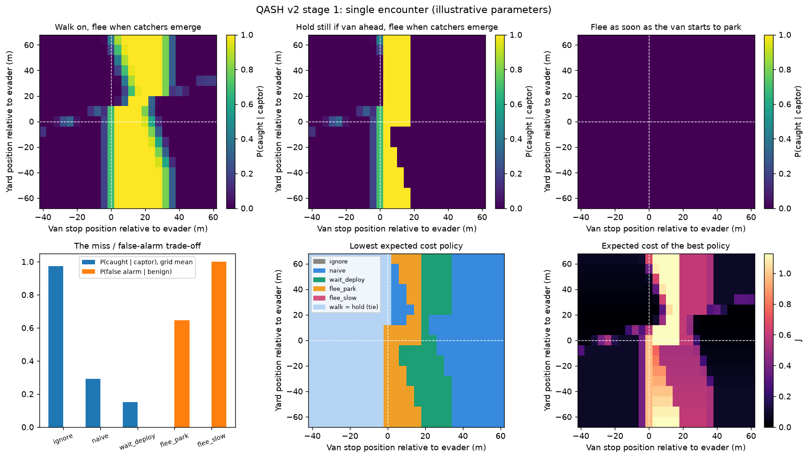
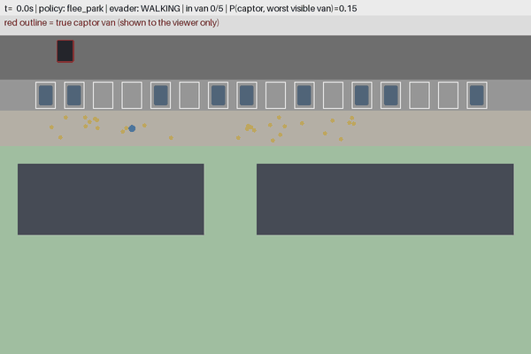
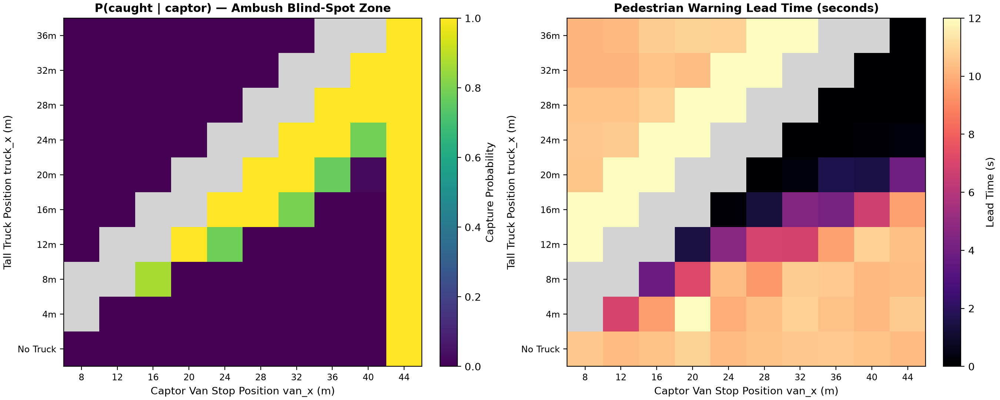

# QASH Engine: Quick Actions in Sudden Hazards

[](https://opensource.org/licenses/MIT)
[](https://www.python.org/downloads/)
[](#qash-v2-stage-2-line-of-sight-occlusion--parking-geometry)

An agent-based stochastic simulation framework modeling urban pursuit-evasion dynamics under partial observability, spatial bottlenecks, and hidden-type threats in high-density courtyard topologies.

---

## QASH v2, Stage 1: Hidden-Type Pursuit and Evasion

**QASH v2 (Stage 1)** replaces the earlier abstract log-odds random-walk addendum with a physical, continuous-space encounter model in metres and seconds (`dt = 0.1 s`).

### Model Overview
A pedestrian walks along a 120 m street segment with courtyard entrances acting as refuges (`x = Y`). A van stops at `x = Δ` and is a *captor van* with prior probability `π = 0.15` (otherwise benign):

- **Van Timeline:** Both types start in `slowing` ~ `U(2, 4)` s. Benign vans pass with probability `p_pass = 0.35`; otherwise, and always for captor vans, the van enters `parking` ~ `U(1, 3)` s followed by `waiting`.
- **Emergence vs. Departure:** A captor team emerges after `τ ~ U(3, 8)` s of waiting and pursues at `5.0 m/s` for up to `15 s`; a benign van leaves after `U(6, 20)` s.
- **Closed-Form Bayesian Posterior:** Because the phase and phase age `a` are observed, the posterior `P(captor | phase, a)` updates analytically via uniform survival functions (peaking at `0.214` during parking and decaying to `0.000` after `8 s` of waiting without emergence).

### Policy Comparison (Base Case, `dt = 0.1 s`, Seed `20261114`)

Evaluated across a `26 × 17` grid (`Δ ∈ [-40, 60]` m, `Y ∈ [-64, 64]` m, 1,000 episodes per van type per cell):

| Policy | Trigger & Pre-Flight Behaviour | $P(\text{caught} \mid \text{captor})$ | $P(\text{FA} \mid \text{benign})$ | Mean Cost $J$ | Lowest-Cost Share |
| :--- | :--- | :---: | :---: | :---: | :---: |
| `ignore` | Never flees; walks on | `0.981` | `0.000` | `1.471` | `0.0%` |
| `naive` | Walks on; flees at emergence | `0.314` | `0.000` | `0.518` | `28.5%` |
| `wait_deploy` | Holds still if van ahead; flees at emergence | `0.161` | `0.000` | `0.584` | `18.3%` |
| `flee_park` | Holds still; flees when van starts to park | `0.000` | `0.647` | `0.937` | `12.4%` |
| `flee_slow` | Flees at first sign of slowing (= static Bayes rule) | `0.000` | `1.000` | `1.275` | `1.1%` |
| **`optimal_dp`** | **Exact belief-MDP backward induction (`BackwardInduction/`)** | **`0.007`** | **`0.117`** | **`0.257`** | **Dominates** |
| *Tie (`naive = wait_deploy`)* | Van stops behind pedestrian (`Δ < 0`) | — | — | — | `39.6%` |

### Risk Maps & Policy Regions



*(If viewing locally, the high-resolution vector figure is available in `UPD/qash_v2_riskmaps.pdf`.)*

---

## Exact Solver & 2D Environment Visualization

- **Exact Belief-MDP Solver (`BackwardInduction/`, `UPD_V2/`):** Computes the optimal dynamic policy via analytical backward induction (`qash_v2_dp.py`, exported metrics in `qash_v2_dp_summary.csv` and `qash_v2_dp_numbers.tex`), achieving grid-mean expected cost $J = 0.257$ ($P(\text{caught} \mid \text{captor}) = 0.007$, $P(\text{FA} \mid \text{benign}) = 0.117$).
- **2D Spatial Layout (`DifferentScenarios/different_scenes.py`):** Illustrates the physical courtyard bottleneck between residential blocks, parallel parking slots, capture quota (`0/5`), and pedestrian crowd dynamics (`n_ped = 30`). Additional baseline clips (`scene_A_empty.gif`, `scene_B_crowd.gif`) are available in `DifferentScenarios/`.



---

## QASH v2, Stage 2: Line-of-Sight Occlusion & Parking Geometry

**Stage 2** (`AlternativeScenarioObstacles/`) relaxes the noise-free phase observability assumption of Stage 1 by introducing a unified 2D line-of-sight occlusion and physical blockage layer (`Obstacle`), while preserving exact model nesting (`check-stage1` passes bit-for-bit when `is_tall = False`).

### Research Question & Unified Obstacle Layer
- **Preregistered Question:** *What is the worst warning lead time the pedestrian can lose under sightline occlusion and parking layout constraints, and does the pursuer team lose as much?*
- **Unified `Obstacle` Abstraction:** Tall parked SUVs (`4.8 m`), delivery trucks (`6.5 m`), angled parking (`45°` / `90°`), and sidewalk roadworks (`22 m`, `H = 3.5 m`) are parameterized by position, length, binary height class (`is_tall`), sidewalk speed factor, and courtyard blockage (`blocks_yard`).
- **Symmetric Channel Decomposition:** Using common random numbers, each obstacle is split into a pedestrian sightline/speed channel (`ped_only`), a pursuer detour delay channel (`team_only`, `+3.0 s`), and the combined symmetric case (`both`).

### Stage 2 Monte Carlo Results (`n = 500`, `van_x = 24 m`, `adaptive_bayes`)

| Scenario (`channel = both`) | $P(\text{caught} \mid \text{captor})$ | $P(\text{FA} \mid \text{benign})$ | Mean Cost $J$ | Effective Warning Lead Time |
| :--- | :---: | :---: | :---: | :---: |
| Parallel Baseline (Low Sedans only) | `0.000` | `0.651` | `0.556` | `10.65 s` |
| Tall Delivery Truck (`x = 12 m`) | `0.863` | `0.103` | `1.348` | `4.35 s` |
| Angled Parking (`45°`) + Tall Truck | `0.959` | `0.056` | `1.448` | `4.05 s` |
| Roadworks Stress Test (`22 m`, Arch Blocked) | `1.000` | `0.000` | `1.460` | `0.00 s` |

> **Key Finding (Asymmetric Sightline Loss):** Unlike symmetric interior partitions, street-level sightline loss hurts the pedestrian far more than detour delay slows the team. When a captor van parks `6–12 m` behind a tall vehicle, an *ambush blind-spot wedge* collapses warning lead time and drives capture risk from `0.000` to `0.863–1.000`.

### 2D Ray-Casting Cones & Ambush Sensitivity Heatmaps




---

## Reproducibility

### Requirements
```bash
pip install numpy matplotlib pillow
