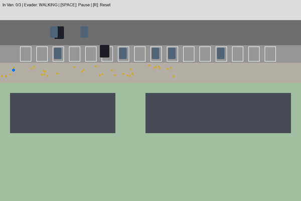

# QASH Engine: Quick Actions in Sudden Hazards

A 2D agent-based stochastic simulation engine (built with Python, Pygame, and Pillow) modeling urban pursuit-evasion dynamics between an evasion agent and an operational patrol unit in a high-density courtyard topology ("Khrushchyovka" arch geometry).



---

## Acknowledgments, AI Collaboration & Theoretical Attribution

> **Theoretical Attribution:**
> The core conceptual framework and theoretical architecture of this project are inspired by and derived from the original repository:
> **[Qoyanshyq Engine by Alibek Bekzhigitov](https://github.com/AlibekBekzhigitov/Qoyanshyq)**

> **AI Assistance Statement:**
> The mathematical formalization, algorithmic refactoring, Red Teaming stress-testing, and codebase structuring for the QASH Engine were developed with the collaborative assistance of Large Language Models (**Google Gemini** and **Anthropic Claude**), acting as interactive academic thought partners.

---

## Key Theoretical Features

* **POMDP Threat Perception:** Dynamic risk assessment with false-positive cognitive noise (civilian minivans vs. operational patrol units).
* **Markov Multi-Stop Patrol Logic:** Non-deterministic patrol stop strategy governed by recruitment KPI quotas and population density.
* **Micro-Local Intercept Kinematics:** Spatial capture triggers bound strictly to local parking slot geometry ($\Delta X \le 55\text{ px}$).
* **Courtyard Arch Topology:** Geometric line-of-sight occlusion and sprint evasion mechanics.

---

## Future Extensions & 3D Roadmap

While the current 2D baseline isolates core linear pursuit-evasion mechanics, future iterations will extend the QASH Engine into a **3D continuous physics environment** (e.g., via MuJoCo or PyBullet):

1. **Volumetric Occlusion Dynamics:** Accounting for 3D sightline blocking by vehicles, fences, and architectural bulkheads.
2. **Multi-Feature Threat Classification:** Integrating Depth LiDAR point-cloud streams processed through **PCA** (Principal Component Analysis) and **DBSCAN** clustering to distinguish patrol agents from civilian crowds by height, gait, and group dispersion.
3. **Height Disparities:** Modeling line-of-sight variations based on standing vs. seated eye-level coordinates ($Z \in [1.1\text{m}, 1.75\text{m}]$).

---

## Repository Structure

```text
.
├── simulation.py        # Core Pygame simulation engine
├── simulation.gif       # Recorded execution preview
├── requirements.txt     # Python dependencies
└── README.md            # Project documentation
